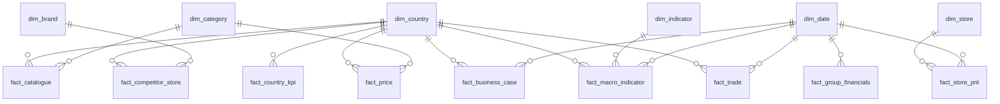

# European Expansion Study: Sephora 2027–2029

> **Comex question:** is opening Sephora stores in a new European country feasible and profitable?
>
> **Answer:** **CONDITIONAL GO for the Netherlands**, with a 15-store plan (3 → 8 → 15 stores, 2027–2029).
> It ranks first under all 5 weightings tested. Base-case NPV **€76 M**, still positive if sales come in 20 % below
> plan (€20 M), but store payback is **5.0 years**, above the 4-year target. **Ireland is the Plan B**: better
> store economics (NPV €90 M, payback 4.5 years) but a smaller, harder-to-supply market.

_All figures are produced by the pipeline (`python -m beauty_expansion.pipeline`) and shown in the Streamlit dashboard.
Data collected 2026-11-11/12._

---

## 1. Company presentation

| | |
|---|---|
| **Company** | **Sephora**, LVMH group, *Selective Retailing* business group (LVMH is listed on Euronext Paris) |
| **Business in France** | Selective beauty retail: fragrance, make-up, skincare, haircare. Third-party brands, exclusive brands and the *Sephora Collection* private label. All stores are company-operated. |
| **Stores in France (X)** | **≈ 330 stores** (Ile-de-France > 75), about 5,000 employees |
| **France revenue** | **€2,511 M** in 2024 (Sephora SAS filed accounts), about **6.9 %** of French household personal-care spending (Eurostat) |
| **Group context** | LVMH Selective Retailing: €18.3 bn revenue in 2025, 9.7 % operating margin (up from 4.5 % in 2021), 59,416 employees. Growth slowed from +26 % (2022) to +0.5 % (2025), which supports the case for new markets. |
| **Target country** | **Netherlands** (chosen by the model among 5 candidates, see §4) |
| **Team** | _First name LAST NAME_ (role), _First name LAST NAME_ (role), _First name LAST NAME_ (role) |

**How the candidates were chosen.** Expansion means a country with **no Sephora store** today. We checked OpenStreetMap
and the press. Germany (since 2017), Belgium (opened June 2026), Luxembourg, Switzerland, Sweden and Denmark already
have stores, so they're excluded. **Candidates: Netherlands, Austria, Ireland, Finland, Norway.** Ireland's only
Sephora is in Belfast (UK, February 2026). See `data/manual/sephora_presence.csv`.

## 2. Scope & data dictionary

### Business terms
| Term | Definition |
|---|---|
| **Personal-care market** | Household final consumption on COICOP 2018 *CP131 Personal care* (Eurostat `nama_10_cp18`): cosmetics, toiletries and personal-care services. It's the widest official proxy for the beauty market. |
| **Fragrance market (apparent consumption)** | Perfumes and toilet waters (HS 3303) that stay in the country: imports − exports, at customs value. Measured for the candidates only, see "Fragrance market from customs data" in §3. |
| **Selective beauty store** | Specialist beauty / perfumery chain (Douglas, ICI Paris XL, Marionnaud, KICKS, Rituals, Kiko…), which competes directly with Sephora. Drugstores (dm, Kruidvat, Boots, Normal…) are indirect competitors. |
| **Catchment area (zone d'achalandage)** | 10 km radius around the centre of each of the 5 largest cities of a country |
| **Effective price index** | Price Sephora can charge for the same products, France = 100 (see business rules) |
| **Gross margin after tax** | (shelf price ÷ (1 + VAT) − landed cost) ÷ net price, weighted by French sales mix. Landed cost = purchase cost + logistics (distance-based) + customs |
| **Trade friction** | Customs duty + customs-clearance cost outside the EU customs union + 1 pt if the currency isn't the euro |
| **Eligible catalogue** | Share of French sales (revenue-weighted) that can be sold at launch: brands not locked by an exclusive local distributor, labels in an accepted language, no pending alcohol approval (Norway) |
| **Payback** | Years for one store's cumulative free cash flow to repay fit-out, opening costs and opening inventory |
| **NPV** | Free cash flow of the 15-store plan 2027–2031 + terminal value (1 % growth), discounted at 8 % |

### Metrics (KPIs) and dimensions
| KPI | Formula | Unit | Grain | Source |
|---|---|---|---|---|
| `market_cagr` | (spend_latest / spend_2019)^(1/n) − 1 | %/yr | country | Eurostat nama_10_cp18 |
| `spend_per_capita_eur` | personal-care spend / inhabitant | €/yr | country × year | Eurostat |
| `market_size_meur` | personal-care spend | M€ | country × year | Eurostat |
| `gross_margin_post_tax` | see definition | % | country | catalogue × VAT × price index × logistics |
| `relative_price_index` *(context)* | PLI country / PLI France × 100 | index | country | Eurostat prc_ppp_ind_1 (A0112) |
| `scraped_price_index` *(context)* | median(price country / price France) × 100, same products | index | country | LOOKFANTASTIC scraper |
| `catchment_density_per_100k` | selective stores within 10 km / city population × 100k | stores | country (5 cities) | OpenStreetMap |
| `leader_store_share` *(context)* | stores of the #1 selective chain / all selective stores | % | country | OpenStreetMap |
| `prime_rent_eur_m2` | prime high-street rent | €/m²/yr | country | Cushman & Wakefield 2025 |
| `hub_distance_km` | mean road distance (1.25 × great-circle) from nearest Sephora hub to competitor stores | km | country | OSM + hubs |
| `trade_friction` | see definition | pts | country | customs / EC / OECD |
| `catalogue_eligible_pct` | see definition | % | country | simulated catalogue |
| `personal_care_share_pct` | personal care / total household consumption | % | country | Eurostat |
| `labour_cost_retail_eur_h` *(business case)* | hourly labour cost, retail trade (NACE G) | €/h | country | Eurostat lc_lci_lev |
| `apparent_consumption_eur` *(fragrance, not scored yet)* | HS 3303 imports − exports, missing when ≤ 0 (net exporter) | € | country × year | Eurostat Comext DS-045409, Statistics Norway 08801 |
| `per_capita_eur` *(fragrance, not scored yet)* | apparent consumption / population | €/inhabitant | country × year | Comext / SSB + Eurostat demo_pjan |
| `perfumeries_per_100k` *(fragrance, not scored yet)* | (OSM `shop=perfumery` + stores of `config.PERFUMERY_CHAINS`, deduplicated) / population × 100k | shops | country | OpenStreetMap + Eurostat demo_pjan |
| `top3_share` *(fragrance, not scored yet)* | shops of the 3 biggest perfumery chains / all perfumeries (independents included); a share of **shop count**, not of sales | share 0–1 (like `leader_store_share`) | country | OpenStreetMap |
| `small_sample` *(fragrance)* | True when a country has fewer than `config.FRAGRANCE_MIN_SHOPS` (100) perfumeries in OSM: its `top3_share` and `leader` are fragile (IE, FI, NO on the 2026-11-13 extract) | flag | country | OpenStreetMap |
| `fragrance_skus_eligible_pct` *(fragrance, not scored yet)* | eligible fragrance SKUs / all fragrance SKUs, **unweighted** (unlike `catalogue_eligible_pct`, which is revenue-weighted and covers all categories) | % (0–100) | country | simulated catalogue |

**Dimensions:** `dim_country`, `dim_date` (actual / plan 2027–2029 / projection), `dim_indicator`, `dim_brand`, `dim_category`, `dim_store`.

### Business rules
1. **Candidates** are European countries with no Sephora store (checked 2026-11). France is the benchmark and is never scored.
2. **Latest year available** per country is used. Norway's spending series stops in 2023, Dutch labour cost in 2024.
3. **Scores** are min-max scaled 0–100 across the 5 candidates (100 = best, direction-aware). Differences < 2 % of the mean count as noise (everyone gets 50).
4. **Price rule:** online, the same products sell at the **same price in every eurozone country** (median scraped index = 100 in NL, AT, IE), even though general price levels differ by up to +35 %. So the margin uses the scraped index, and for FI/NO the Eurostat price gap × the pass-through observed in the scraped countries (0 %).
5. **Selective Retailing ≠ Sephora:** LVMH only publishes the business group (Sephora + DFS + Le Bon Marché), so we use it as a proxy and say so.
6. **Source anomaly kept, not fixed:** LVMH's ESG Data Book 2025 business-group headcounts sum to 211,551 vs a published total of 211,552. We use the detailed figures.
7. **Decision rule** (written before the results, `analysis/decision.py`): shortlist by score. If the top two are within 2 points, the higher base-case NPV wins. Then: **GO** = NPV > 0, payback ≤ 4 years, pessimistic NPV > 0. **CONDITIONAL GO** = NPV > 0 but a condition fails. **NO-GO** = NPV ≤ 0.
8. **Net exporters aren't measured with trade data:** when fragrance imports − exports ≤ 0 (France), the fragrance market is left missing, not shown as negative.
9. **Fragrance focus is a stress test, not the score:** it re-weights the Market axis on the fragrance market and never replaces the base ranking. Because the Dutch fragrance level is an upper bound, its result is read together with the break-even check in the fragrance deep-dive (§4).

## 3. Architecture & data sources


### Star schema (`sql/schema.sql`)

Each fact has a single, documented grain (see the comments in `schema.sql`). KPIs are computed **with SQL on the star schema** (`analysis/kpis.py`).

### Why these sources
| Source | Type | Data | Why it's relevant | Limits |
|---|---|---|---|---|
| **Eurostat API** | Open data API | population, GDP/capita, personal-care spending & share, HICP, price levels, retail labour cost | official, harmonised across all candidates, yearly refresh | CP131 includes personal-care *services* (hairdressers) |
| **Eurostat Comext + Statistics Norway** | Open data APIs | imports and exports of perfumes & toilet waters (HS 3303), 2019–2025, 6 countries | the only free, harmonised measure of the fragrance market by country | customs values, not retail prices; France (net exporter) can't be measured; Dutch figures still include some transit |
| **OpenStreetMap (Overpass)** | Open data API | 6,460 beauty stores geolocated (18 chains), city populations | only free geolocated source of competitor stores | crowd-sourced: coverage uneven. Nordic chains often lack `brand` tags, so we added an exact-name lookup. Drugstores in Ireland (Boots) are under-mapped. |
| **LOOKFANTASTIC scraper** | Web scraping | 17 identical products × 4 countries | real shelf prices, same SKU across countries | online channel only; Sephora, Notino and Douglas block scripts (403), and we respected that |
| **LVMH ESG Data Book + results** | Public Excel / press releases | Selective Retailing revenue, margin, headcount 2021–2025 | real economics of the business group | not Sephora-only |
| **Cushman & Wakefield, EC, OECD, national customs** | Manual, cited | prime rents, VAT, corporate tax, duties | authoritative references | prime-street rents; applied with a 45 % factor for normal locations |
| **Simulated internal databases** | Seeded generator calibrated on public totals | 330 French store P&Ls, 2,000-SKU catalogue with eligibility flags | the brief allows simulated internal data; totals match Sephora France revenue and LVMH margins | individual rows are synthetic |

### Fragrance market from customs data (`extract/comext.py`)
No public source gives fragrance sales by country: Eurostat's personal-care spending mixes fragrance with make-up,
skincare and hairdressers. Customs data does isolate it. What enters a country minus what leaves it is roughly what
is consumed there (**apparent consumption**).

- **Formula.** The full formula is production + imports − exports. We tested Eurostat PRODCOM (DS-059367, codes
  20421150 + 20421170): the candidates produce almost no fragrance (Finland 0, Austria 0 for toilet waters,
  Netherlands and Ireland confidential), so imports − exports is a fair proxy for them.
- **France can't be measured this way.** It exports ten times what it imports (2025: €8.1 bn vs €0.8 bn). Even with
  its production (€4.3 bn, PRODCOM) the balance is −€2.9 bn, because production is valued at factory price and
  exports at border price, brand value included. France is left missing. The score only compares candidates, so
  this doesn't block the ranking.
- **Netherlands: the Rotterdam effect.** Raw imports (€1.9 bn in 2025) overstate the Dutch market, because €1.5 bn
  leaves again through Rotterdam and European distribution centres. Imports − exports (€457 M) removes most of this,
  but the series jumps from year to year (€157 M in 2021, €342 M in 2022), so some transit is probably left. Read the
  Dutch level and growth as an upper bound.
- **Customs values, not retail prices.** Imports are valued CIF and exports FOB: the figures compare countries with
  each other, they aren't the size of the retail market.
- **Norway** isn't in Comext. We use Statistics Norway table 08801 (sum of the national codes under HS 3303),
  converted from NOK at the Eurostat annual average rate.

| 2025 (M€) | Imports | Exports | Apparent consumption | Per inhabitant | Growth 2019–2025 |
|---|---|---|---|---|---|
| Ireland | 170 | 14 | 157 | €28.8 | +12.9 %/yr |
| Netherlands | 1,914 | 1,457 | 457 | €25.3 | +16.3 %/yr (upper bound) |
| Austria | 347 | 126 | 220 | €24.0 | +7.4 %/yr |
| Norway | 105 | 4 | 101 | €18.0 | +21.3 %/yr |
| Finland | 47 | 4 | 43 | €7.6 | +16.4 %/yr |
| France | 821 | 8,088 | not measurable (net exporter) | – | – |

Output: `data/processed/fragrance_market.csv` and the `fact_trade` table, one row per country and year (2019–2025).
How this changes the ranking is covered by the fragrance deep-dive (issue #5).

## 4. Results

### Attractiveness ranking (weights in `config.py`)
| Country | Score /100 | Market | Price & margin | Network | Operations | Assortment |
|---|---|---|---|---|---|---|
| **Netherlands** | **79.7** | 86 | 100 | 32 | 100 | 85 |
| Austria | 75.2 | 75 | 98 | 34 | 80 | 96 |
| Ireland | 74.6 | 67 | 74 | 79 | 65 | 95 |
| Finland | 34.0 | 0 | 15 | 82 | 54 | 44 |
| Norway | 26.7 | 34 | 0 | 82 | 0 | 0 |

**Weights:** Market & potential 30 % (growth 12, spend/capita 10, size 8) · Price & margin 20 % (gross margin after tax) ·
Network 20 % (catchment density 10, rent 10) · Operations 15 % (hub distance 8, trade friction 7) · Assortment 15 % (eligible catalogue 8, category share 7).
Market gets the most weight because it caps achievable revenue. Margin is one KPI, so the price level isn't counted twice.

**Robustness:** the Netherlands stays first under all 5 weightings tested (base, market first, margin first,
low risk / operations, equal weights), 4.5 to 13.3 points ahead of the runner-up.

### Key insights
- **The Netherlands has the biggest market** (€12.8 bn of personal-care spending, +5.8 %/yr since 2019, €710 per head vs €530 in France), the **best margin after tax** (45.6 %, the same as France) and the **easiest supply**: 268 km on average from the Düren hub, which already serves Sephora Germany.
- **Its weak spot is competition:** 4.6 selective beauty stores per 100k inhabitants around the 5 largest cities (France: 7.6), led by **ICI Paris XL (37 % of selective stores)** and Douglas. Sephora has to win on concept and exclusive brands, not on white space.
- **Ireland has the best store economics** (fastest growth +6.4 %/yr, least crowded at 1.1 stores per 100k, cheapest retail labour at €32/h, 15 % corporate tax), but it's a small market (€3.8 bn) and the nearest EU hub is 1,071 km away. Since Brexit, the UK hub (Coventry) can't supply it without customs.
- **Austria has rich consumers** (€770 per head) but **Vienna's prime rent (€5,520/m²) cuts the store EBITDA margin to 5 %**.
- **The Nordics fail on margin:** 25–25.5 % VAT on euro-harmonised prices and about 1,300–1,500 km from the nearest hub. Norway adds customs and the NOK, and only 62 % of the catalogue could be sold at launch.
- **Price harmonisation is the hidden finding:** general price levels are 12–45 % above France's, yet the same beauty products cost the same online (median scraped index 100 in NL, AT, IE). A margin must not assume local price levels.

### Business case: 15 stores (3 in 2027, +5 in 2028, +7 in 2029), 350 m² each
| | **Netherlands** | Ireland | Austria | Finland | Norway |
|---|---|---|---|---|---|
| Mature store revenue | **€6.3 M** | €6.6 M | €6.9 M | €5.0 M | €4.6 M |
| Store EBITDA margin (after central costs) | **12 %** | 12 % | 5 % | 9 % | 1 % |
| Store payback | **5.0 yrs** | 4.5 yrs | > 10 yrs | 6.6 yrs | never |
| Plan capex + opening inventory | **€34.9 M** | €35.8 M | €36.0 M | €33.4 M | €32.6 M |
| NPV base / pessimistic (−20 % sales) | **€76 M / €20 M** | €90 M / €28 M | €16 M / −€59 M | €44 M / €5 M | −€26 M / −€68 M |

Netherlands plan: revenue €13 M (2027) → €79 M (2029) → €95 M (2031). Free cash flow is negative during the roll-out
(≈ −€27 M cumulated 2027–2029) and positive from 2030 (+€8–9 M per year), so **most of the NPV comes from the terminal
value**: the network has to keep running beyond 2031 to create value.

### Decision: CONDITIONAL GO for the Netherlands
- **Selection:** highest attractiveness score, 4.5 points ahead of Austria, and first under every weighting.
- **Checks:** ✅ NPV > 0 (€76 M) · ❌ store payback 5.0 years vs 4-year target · ✅ NPV still positive at −20 % sales (€20 M).
- **Trade-off for the Comex:** Ireland has better store economics (higher NPV, faster payback) but a smaller market
  that is harder to supply and to scale beyond 15 stores. **Plan B = Ireland.**

**Conditions for a full GO:** bring payback under 4 years by (a) securing average rents at or below 45 % of
P.C. Hooftstraat prime (≈ €1,260/m²), (b) a 3-store pilot in 2027 (Amsterdam, Rotterdam, Utrecht) that must reach 70 %
of the mature sales target in year 1, and (c) exclusive brands and a strong loyalty offer to take share from
ICI Paris XL and Douglas, plus securing the ~9 % of sales currently held by exclusive local distributors.

### Fragrance deep-dive
Fragrance is Sephora's core category. This section looks at it on its own (dashboard tab "🌸 Fragrance", slide in
`docs/slides/fragrance.md`).

**Does the Netherlands stay first when fragrance is scored? Yes, with a condition.** In the sensitivity scenario
"Fragrance focus" the Market axis (30 %, same 12 / 10 / 8 weights) is measured on the fragrance market from customs
data instead of total personal-care spending. The Netherlands scores **78.1**, Ireland 71.4, Austria 63.9: first, **6.7 points
ahead**, and first in all 6 scenarios. But the Dutch fragrance market is an **upper bound** (Rotterdam transit, see
below). **Rough estimate:** if the true Dutch level were about 40 % below the customs estimate (≈ €270 M instead of
€457 M), Ireland would overtake. Method: lower the Dutch market size and per-head figures by the same percentage, keep
its growth, re-run the scoring with the "Fragrance focus" weights and find the point where both scores are equal
(NL 78.1 → 73.2, IE 71.4 → 73.2). Reproduce it with `python -m beauty_expansion.analysis.fragrance_breakeven` (after the
pipeline). Limits of this estimate: it assumes the same percentage error on size and per-head figures, and keeps the
Dutch growth, which is probably an upper bound too. The Dutch series itself moved between €157 M (2021) and €342 M
(2022). The base score (79.7) doesn't use these figures.

**Insights**
1. **Ireland and the Netherlands lead per head, the Nordics grow fastest, and only the Netherlands is big.** Fragrance
   market per inhabitant in 2025: Ireland €28.8, Netherlands €25.3, Austria €24.0, Norway €18.0, Finland €7.6
   (France can't be measured, see rule 8). Growth 2019–2025: Norway +21.3 %/yr, Finland +16.4 %, Netherlands
   +16.3 % (upper bound), Ireland +12.9 %, Austria +7.4 %. At €457 M the Dutch market is 2.9 times Ireland's (€157 M).
2. **The Rotterdam effect makes raw trade figures useless for the Netherlands.** Raw imports were **€1,914 M** in 2025,
   but €1,457 M (76 %) leave again as exports. Apparent consumption (imports − exports) is **€457 M**, 24 % of imports.
   Even that is probably too high: this is why the Dutch level and growth must be read as an upper bound, and why the
   conclusion above carries a condition.
3. **No price edge, and a thinner fragrance competition than in France.** Online, the same perfume costs the same in
   France, the Netherlands, Austria and Ireland (median **€1.38 per ml** incl. VAT; index 100 everywhere). Ex-VAT, a bottle
   earns 0.8 % less in the Netherlands (index 99.2) and 2.4 % less in Ireland (97.6). The Netherlands has **2.1 perfumeries
   per 100k** inhabitants (France 2.5) and, around its 5 largest cities, **4.4 vs 9.4 in France**. **ICI PARIS XL** leads,
   and the 3 biggest chains hold **62 % of perfumeries** (a share of shop count, not of sales). About 90 % of the French
   fragrance range could be sold at launch (**simulated** catalogue; the rest sits with exclusive local distributors).

**Sources of the fragrance figures**
| Figure | Source | Produced by | File |
|---|---|---|---|
| Apparent consumption, imports, exports, per capita, growth (HS 3303) | Eurostat Comext DS-045409, Statistics Norway 08801, Eurostat demo_pjan | issue #2 | `fragrance_market.csv` |
| Price per ml, like-for-like price index (FR, NL, AT, IE) | LOOKFANTASTIC scraper, collected 2026-11-12 | issue #3 | `fragrance_prices.csv`, `fragrance_price_summary.csv` |
| Perfumeries per 100k, leader, top-3 share, independents | OpenStreetMap (`shop=perfumery` + chains), extract of 2026-11-13 | issue #4 | `fragrance_competition.csv` |
| Fragrance SKUs sellable at launch | **Simulated** internal catalogue | issue #4 | `fragrance_competition.csv` |
| Scenario "Fragrance focus" | Weights in `config.py` (ASSUMPTION), KPIs from `fragrance_market.csv` | issue #5 | `sensitivity.csv` |

Limits: customs values are not retail prices; France cannot be measured with trade data (net exporter); the Dutch figures
are an upper bound; prices are online only, and Finland and Norway have no LOOKFANTASTIC site; Ireland, Finland and Norway
have fewer than 100 perfumeries in OpenStreetMap, so their shares are fragile (`small_sample`).

### Correction log
A first run sent Ireland's supply through Sephora UK's Coventry hub, which made Ireland look closer (495 km) and
ranked it joint first. Since Brexit, UK → Ireland shipments go through customs, so hubs are now restricted to the EU
customs union (`data/manual/logistics_hubs.csv`). Ireland dropped to third, and the Netherlands became first under every
weighting. We keep this note because it shows why each source assumption is checked.

## 5. Organisation & roadmap

| Member | Role |
|---|---|
| _Name_ | Data engineering: extractors, scraper, pipeline |
| _Name_ | Data modelling: star schema, SQL, data quality |
| _Name_ | Analysis: KPIs, scoring, business case |
| _Name_ | DataViz, AI summary, Comex presentation |

**Method:** short weekly sprints, one Git branch per module with pull-request review, assumptions centralised in `config.py`, every manual figure stored with its source URL.

**Next steps (post-study recommendations):**
1. Replace the simulated store P&L with Sephora's real store data, then re-run the pipeline (it's built for that).
2. Ask local brokers for real rent quotes in Amsterdam (Kalverstraat, P.C. Hooftstraat), Rotterdam (Lijnbaan) and the large malls (Westfield Mall of the Netherlands, Hoog Catharijne).
3. Check the exclusive-distribution contracts of the top 50 brands in the Netherlands (and Ireland as Plan B).
4. Scrape physical-store prices (ICI Paris XL, Douglas NL) to confirm price harmonisation offline.
5. Run a 3-store pilot in 2027, with a go/no-go gate in the first quarter of 2028 before opening the next 12 stores. Keep Ireland as option 2.

## 6. Technical stack

| Layer | Tools |
|---|---|
| Language | Python 3.12 |
| Collection | `requests` (Eurostat, Comext, Statistics Norway & Overpass APIs), `BeautifulSoup` (scraper), `openpyxl`/`pandas` (Excel) |
| Wrangling | `pandas`, `numpy` |
| Storage / modelling | **DuckDB** star schema (`sql/schema.sql`), file `data/processed/warehouse.duckdb` |
| Analysis | Python modules in `src/beauty_expansion/analysis/` |
| AI | Claude Opus 5.5 via the `anthropic` SDK, with structured JSON output and refusal fallback. A rule-based fallback runs without a key. |
| DataViz | Plotly + **Streamlit** dashboard (`app/streamlit_app.py`). CSV exports in `data/processed/` for Power BI/Tableau users. |
| Versioning | Git |

## How to run

```bash
python3.12 -m venv .venv && source .venv/bin/activate
pip install -r requirements.txt && pip install -e .
cp .env.example .env                       # optional: add ANTHROPIC_API_KEY for the AI summary
python -m beauty_expansion.pipeline        # ~2 min with cache, ~15 min first run (--refresh to re-download)
streamlit run app/streamlit_app.py         # opens the dashboard
```

Change an assumption in `src/beauty_expansion/config.py` (weights, rents, ramp-up, WACC…), re-run, and the dashboard updates.

## Repository map
```
src/beauty_expansion/
  config.py             every assumption, with its source or "ASSUMPTION"
  extract/              eurostat.py · osm.py · prices.py (scraper) · comext.py (customs) · lvmh.py · internal.py (simulated)
  transform/geo.py      distances, catchment areas
  load/warehouse.py     DuckDB star schema loader
  analysis/             kpis.py · scoring.py · business_case.py · decision.py · ai_summary.py · fragrance_breakeven.py
  pipeline.py           one command, end to end
sql/schema.sql          star schema
app/streamlit_app.py    dashboard
data/manual/            hand-collected figures with sources (committed)
lessons/                Python learning path (see LEARNING_PATH.md)
```
